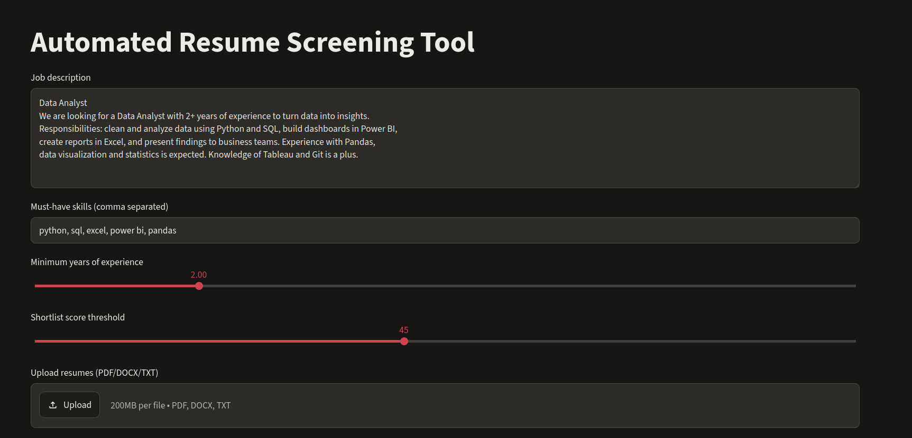
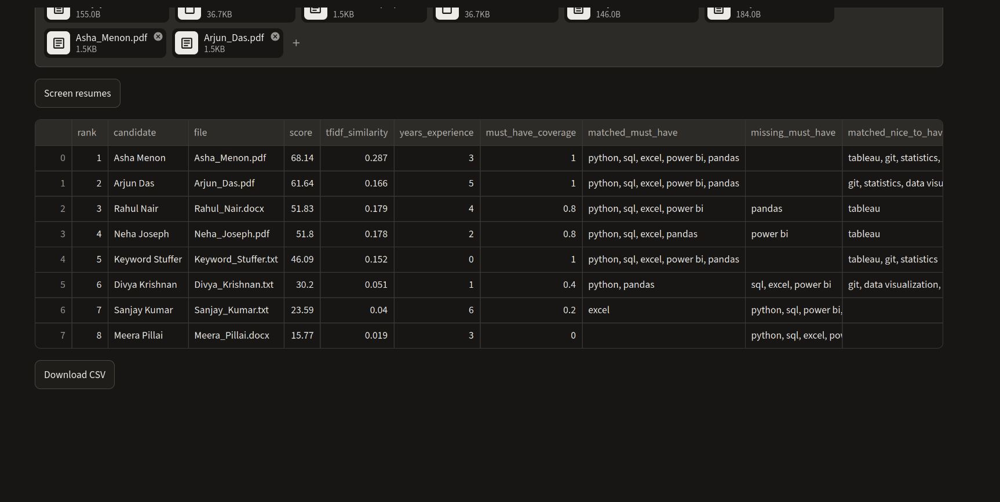
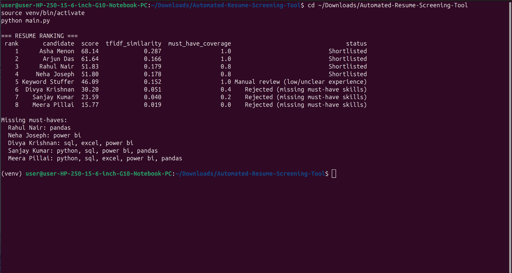

# Automated Resume Screening Tool

Python tool that reads resumes (PDF / DOCX / TXT), compares them with a job description using **TF-IDF + cosine similarity** and **skill matching**, ranks candidates and exports a CSV shortlist report. Optional Streamlit dashboard.

## Problem Statement
Recruiters receive hundreds of resumes per role. Manual screening is slow and inconsistent. This tool standardises first-round screening using transparent, explainable scoring.

## Features
- Text extraction from PDF, DOCX and TXT
- Cleaning (lowercase, email/phone removal, regex)
- Skill extraction with aliases (e.g. `powerbi` = `power bi`)
- TF-IDF cosine similarity between resume and job description
- Must-have gap detection and experience check
- Shortlist / Reject / Manual-review decision with reasons
- CSV report + Streamlit dashboard

## Scoring
`score = 100 x (0.40 x TF-IDF similarity + 0.35 x must-have coverage + 0.10 x nice-to-have coverage + 0.15 x experience)`

Shortlisted if must-have coverage >= 60%, score >= 45 and experience is not clearly missing. Weights are in `src/scorer.py`.

## Folder Structure
```
Automated-Resume-Screening-Tool/
├── resumes/            sample resumes (synthetic)
├── data/               job_description.txt, skills.json
├── src/                extractor, cleaner, skills, scorer, report, pipeline
├── outputs/            ranking_report.csv
├── images/             screenshots
├── docs/               notes
├── generate_samples.py creates synthetic resumes
├── main.py             command-line run
├── app.py              Streamlit dashboard
└── requirements.txt
```

## How to Run
```bash
python3 -m venv venv
source venv/bin/activate          # Windows: venv\Scripts\activate
pip install -r requirements.txt
python generate_samples.py
python main.py
streamlit run app.py              # optional dashboard
```

## Sample Output
See `outputs/ranking_report.csv` and `images/`.

## Limitations & Ethics
Synthetic data only. Keyword matching can be gamed; final decisions should stay with humans. The tool never uses name, gender, age or other sensitive attributes for scoring, and removes emails/phones before analysis.

## Future Improvements
Semantic embeddings (sentence-transformers), NER for education/experience, FastAPI backend, Next.js recruiter dashboard.

## Learning Outcomes
File parsing, NLP preprocessing, TF-IDF, cosine similarity, modular Python design, pandas reporting, Git/GitHub workflow.

## Screenshots

**Dashboard input**


**Ranking table**


**Terminal output**

